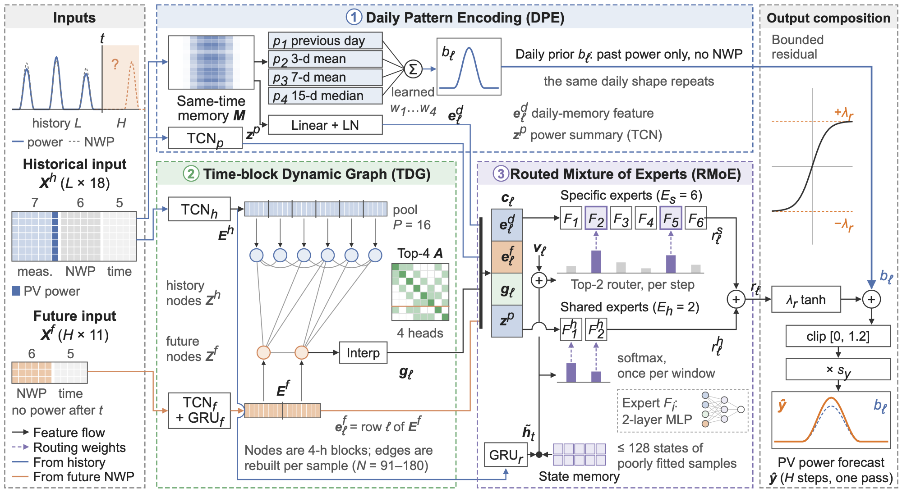

# DPDG-MoE: Daily Prior and Dynamic-Graph Mixture of Experts for Multi-Horizon PV Power Forecasting

Official PyTorch implementation of **DPDG-MoE**, from the paper
*"Daily Prior and Dynamic-Graph Mixture of Experts Network for Multi-Horizon Photovoltaic Power Forecasting"*
(under review).

DPDG-MoE forecasts a whole window of 15-min PV power (4 h to 7 d) in one forward pass. The forecast is a
periodic **daily prior** built from past power plus a **bounded residual** predicted by a mixture of experts
that reads numerical weather prediction (NWP) through a sample-dependent time-block graph.



| Module | Role | Code |
| --- | --- | --- |
| Daily Pattern Encoding (DPE) | Four same-time statistics of past power (previous day, 3-d mean, 7-d mean, 15-d median) are combined with four learned coefficients (softmax of four logits, initialized at 0.60/0.25/0.10/0.05) into the prior `b`. The same history also yields the daily-pattern feature `e^d` and the power summary `z^p` used by the experts. | `prior_logits`, `daily_memory_proj`, `power_encoder` |
| Time-block Dynamic Graph (TDG) | Encodes history and future inputs, pools them into 4-h block nodes, and passes messages over a Top-4 graph rebuilt for every sample. | `history_encoder`, `future_encoder`, `TimeBlockGraph` |
| Routed Mixture of Experts (RMoE) | Six Specific experts with step-wise Top-2 routing and two Shared experts predict the residual `r`; a state memory of poorly fitted training samples refines the routing state. | `specific_*`, `shared_*`, `routing_gru`, `state_memory` |

Output: `u = clip(b + λ_r · tanh(r), 0, 1.2)`, rescaled to MW. See [`dpdgmoe/models/dpdgmoe.py`](dpdgmoe/models/dpdgmoe.py);
comments reference the equation numbers of the paper.

## Repository layout

```
├── configs/dpdgmoe.json        # settings per horizon, ablation variants, and the 20 runs of the paper (paper_tasks)
├── data/                       # the four PVOD stations used in the paper (see data/README.md)
├── dpdgmoe/
│   ├── data.py                 # loading, chronological split, windows, daily memory and priors
│   ├── models/dpdgmoe.py       # DPDG-MoE
│   ├── baselines/              # Cross-Unet, PatchTST, TimeMixer, iTransformer, TimesNet + common adapter
│   │   └── adapted/            # AMPDNet, G-GraphTST, TFCNet, CausalFormer, SolarCAST, WinFlashDilated-former
│   ├── trainer.py              # training, validation-based selection, evaluation, checkpoints
│   └── metrics.py              # MAE, RMSE, R², DayMAE, MAPE
├── scripts/
│   ├── run_benchmark.py        # paper runs, ablations, sensitivity runs and comparators, with summary.csv
│   ├── evaluate.py             # re-evaluate a saved checkpoint
│   └── convert_legacy_checkpoint.py
└── tests/                      # unit and smoke tests (synthetic data, CPU)
```

## Installation

Python ≥ 3.10. The experiments of the paper used PyTorch 2.11.0 (CUDA 12.8) on one NVIDIA RTX 4090.

```bash
git clone <this repository> && cd <repository>
python -m venv .venv && source .venv/bin/activate
pip install -r requirements.txt        # install the torch build for your CUDA version first if needed
```

or, with [uv](https://docs.astral.sh/uv/): `uv sync` (uses `uv.lock`) or `uv venv && uv pip install -r requirements.txt`.

## Data

`data/S-1.csv` … `data/S-4.csv` are stations `station00`, `station01`, `station07` and `station08` of the public
PVOD dataset (Yao et al., 2021), taken unchanged from the preprocessed archive released with Cross-Unet
(Zhang et al., 2026). Each file holds onsite measurements, WRF NWP and power at 15-min resolution.
Column descriptions, provenance and checksums are in [`data/README.md`](data/README.md).

Protocol (identical for every model):

- input: 15-day history (1,440 steps) of 7 onsite variables, 6 NWP variables and calendar features, plus the 6 NWP variables over the forecast window;
- horizons: 16, 48, 96, 384 and 672 steps (4 h, 12 h, 1 d, 4 d, 7 d); the code also accepts 1,440 steps (15 d);
- chronological 80/10/10 split; a forecast window must lie entirely inside one segment;
- all scaling statistics come from the training segment; model selection uses the validation segment only.

## Quick start

```bash
# Train and test DPDG-MoE on station S-2, 1-day horizon, one seed
python scripts/run_benchmark.py --stations S-2 --horizons 96 --seeds 2026 --batch-size 352 --output-dir runs/demo

# Re-evaluate the saved checkpoint
python scripts/evaluate.py runs/demo/S-2/H96/DPDG-MoE/seed_2026/checkpoint.pth --split test
```

Each run directory contains `checkpoint.pth`, `metrics.json` (settings, learned prior coefficients, split
sizes, validation and test metrics), `training_history.json`, and `validation.npz` / `test.npz` with
predictions and targets in MW. `--resume` skips runs that already finished; an interrupted run resumes from
its last completed epoch.

Using the model directly:

```python
from dpdgmoe import PVForecastData
from dpdgmoe.trainer import build_dpdgmoe, dpdgmoe_settings

data = PVForecastData("data/S-2.csv", horizon=96)
model = build_dpdgmoe(data, dpdgmoe_settings(horizon=96))
```

## Reproducing the paper

Every DPDG-MoE result in the paper is a single training run per site and horizon: at most 200 epochs, early
stopping after 8 epochs without a lower validation loss, and the checkpoint with the lowest validation loss.
The seed, batch size and task-specific settings of each run are listed under `paper_tasks` in
[`configs/dpdgmoe.json`](configs/dpdgmoe.json). Batch sizes are 256 (4 h), 384 (12 h), 352 (1 d), 192 (4 d)
and 160 (7 d). Four runs use settings that differ from the horizon defaults:

| Site | Horizon | Change |
| --- | --- | --- |
| S-4 | 4 h | learning rate halved |
| S-4 | 4 d | settings of the 1-day horizon |
| S-3 | 7 d | settings of the 1-day horizon |
| S-4 | 7 d | learning rate 5e-5 |

**Main results** (20 runs):

```bash
python scripts/run_benchmark.py --paper-tasks --output-dir runs/paper
```

**Ablations** (4 h, 12 h and 1 d; each variant starts from the reference run of that site and horizon and
changes one component):

| Group | Variant | Change |
| --- | --- | --- |
| Prior | `no_prior` | no daily prior; the residual is the whole forecast |
| | `fixed_prior` | prior coefficients stay at their initial values |
| | `adaptive_prior` | coefficients computed per sample and step by a router |
| | `prior_only` | prior without residual; only the four coefficients are trained |
| Graph | `static_graph` / `no_graph` | trainable sample-independent graph / no message passing |
| Experts | `specific_only` / `shared_only` | keep one expert branch |
| | `dense_routing` | dense softmax over Specific experts instead of Top-2 |
| | `single_residual` | one unrouted residual head |
| Inputs | `no_state_memory` | disable the state memory |
| | `no_future_nwp` | mask future NWP, keep calendar features |
| | `no_daily_feature` / `no_power_summary` | zero `e^d` / `z^p` in the expert context |

```bash
for v in no_prior fixed_prior adaptive_prior prior_only static_graph no_graph specific_only shared_only \
         dense_routing single_residual no_state_memory no_future_nwp no_daily_feature no_power_summary; do
  python scripts/run_benchmark.py --paper-tasks --variant $v --horizons 16 48 96 --output-dir runs/ablation
done
```

**Hyperparameter sensitivity** (4 h, 12 h and 1 d; one setting changed at a time from the reference run):

```bash
for s in graph_topk=2 graph_topk=6 graph_topk=8 n_specific_experts=4 n_specific_experts=8; do
  python scripts/run_benchmark.py --paper-tasks --set $s --horizons 16 48 96 --output-dir runs/sensitivity
done
```

Ablation and sensitivity runs use the `ablation_seed` of each task, which equals the seed of the main run
except for S-4 at 4 h, where the reference is the run with the default learning rate. `--paper-tasks` sets
seeds and batch sizes itself; the `prior_only` variant uses a batch of 128 (4 h) or 192 (12 h, 1 d).

**Reproducibility.** With the same GPU type, PyTorch version and batch size, the code reproduces the stored
test predictions of the paper's checkpoints exactly. GPU training is not bit-deterministic, and inference on
another device or with another batch size changes floating-point rounding, which can switch the Top-k
choices of a few windows, so retrained numbers can differ slightly from the paper. Checkpoints are not
included in the repository because of their size.

## Comparison models

All eleven comparison models receive the same windows and future NWP as DPDG-MoE, are trained with MSE on
standardized power, and keep the checkpoint with the lowest validation MSE. The paper reports the mean of
seeds 2026, 2027 and 2028 for each comparator.

| Group | Models | Implementation |
| --- | --- | --- |
| Vendored | Cross-Unet, PatchTST, TimeMixer, iTransformer, TimesNet | Official code (see [`NOTICE`](NOTICE)), wrapped by [`BaselineAdapter`](dpdgmoe/baselines/adapter.py), which resamples future NWP to the history length and adds a step-aligned GRU correction head. Adam, lr 1e-4. |
| Structural adapters | AMPDNet, G-GraphTST, TFCNet, CausalFormer, SolarCAST, WinFlashDilated-former | Re-implementations in [`dpdgmoe/baselines/adapted/`](dpdgmoe/baselines/adapted/) that keep each paper's distinguishing operations and condition every forecast step on future NWP. AdamW, lr 2e-4, weight decay 5e-4, gradient clipping 1.0. |

Training budgets of the comparator runs in the paper (early-stopping patience 8 for all):

| Models | Batch size | Maximum epochs |
| --- | --- | --- |
| Cross-Unet, PatchTST, TimeMixer | 32 | 100 |
| AMPDNet, G-GraphTST, TFCNet | 32 | 50 |
| iTransformer, TimesNet, CausalFormer, SolarCAST, WinFlashDilated-former | 128 | 50 |

```bash
python scripts/run_benchmark.py --models Cross-Unet PatchTST TimeMixer --batch-size 32 --epochs 100 --output-dir runs/comparators
python scripts/run_benchmark.py --models AMPDNet G-GraphTST TFCNet --batch-size 32 --epochs 50 --output-dir runs/comparators
python scripts/run_benchmark.py --models iTransformer TimesNet CausalFormer SolarCAST WinFlashDilated-former \
    --batch-size 128 --epochs 50 --output-dir runs/comparators
```

The structural adapters are **not** reproductions of the authors' repositories. `ADAPTER_METADATA` in
[`adapted/__init__.py`](dpdgmoe/baselines/adapted/__init__.py) records the substitutions, and each run's
`metrics.json` carries them. In short: CausalFormer was proposed for temporal causal discovery and is used here as a
forecasting architecture; SolarCAST builds its graph over the station's variables because no neighboring-station
GHI is available; TFCNet uses an MLP output head instead of the original KAN head; WinFlashDilated-former uses exact
PyTorch window attention instead of the FlashAttention-3 kernel.

## Tests

```bash
pip install pytest
python -m pytest tests          # about one minute on a laptop CPU
```

## Citation

```bibtex
@article{dpdgmoe,
  title   = {Daily Prior and Dynamic-Graph Mixture of Experts Network for Multi-Horizon Photovoltaic Power Forecasting},
  author  = {Anonymous},
  journal = {Under review},
  year    = {2026}
}
```

Please also cite PVOD (Yao et al., *Solar Energy* 230, 2021, doi:10.1016/j.solener.2021.09.050) when using the data.

## License

Code in this repository is released under the [Apache License 2.0](LICENSE). Vendored baseline code keeps its
original license (see [`NOTICE`](NOTICE)); the data files follow the terms of the PVOD dataset.
